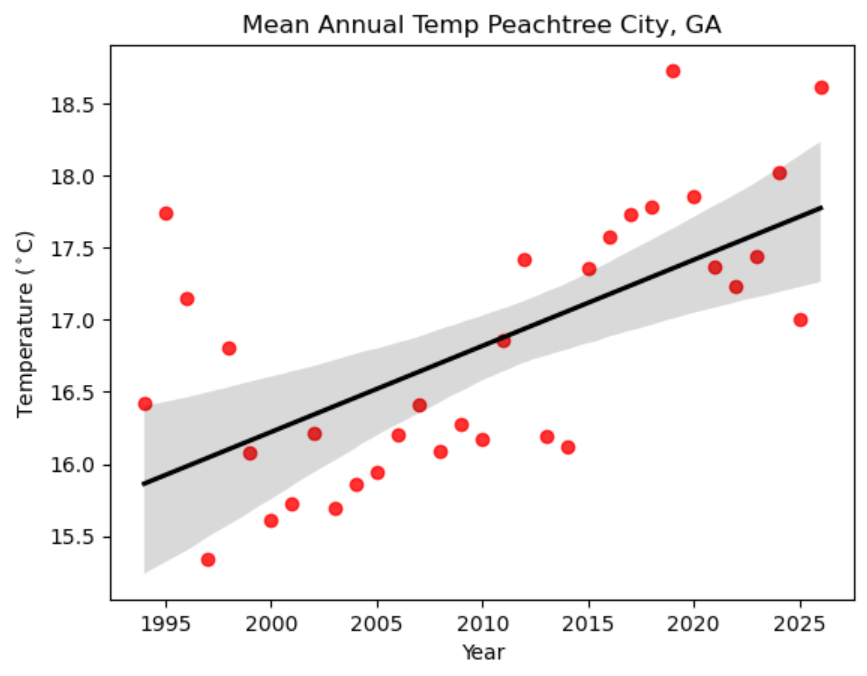
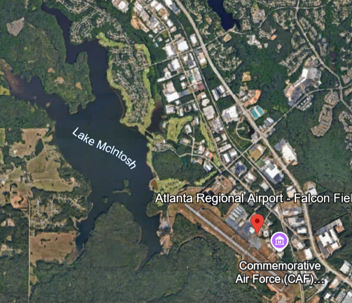

### Michael Pitts
Undergraduate at CU Boulder studying Geography w/ GIS emphasis, minor in Atmospheric and Oceanic Science. Currently working on GIS project for the community of Beulah Valley, Colorado to help recover after the Aspen Acres Fire. 

### Contact Information
* michael.pitts@colorado.edu
* [www.linkedin.com/in/michaelpitts21](www.linkedin.com/in/)

### Lake Peachtree
Map of Lake Peachtree located in Peachtree City, Georgia.

<embed type="text/html" src="img/lakeptc.html" width="600" height="600">

## Temperature Trend in Peachtree City, Georgia

### Overview

This project examines long-term changes in annual average temperature in Peachtree City, Georgia. Historical climate observations from Atlanta Regional Airport-Falcon Field were used to calculate annual average temperature and identify if a long-term trend exists. Unfortunately, data at this site only goes back to 1994 but is the most reliable data source in Peachtree City. 

### Data and Methods

I used historical climate data from NOAA's National Centers for Environmental Information (NCEI) through the Climate Data Online (CDO) portal. Monthly average temperature observations were grouped by year to calculate annual average temperature. A linear regression was then used to estimate the long-term trend in annual temperature.

### Annual Temperature Trends

**Figure 1. Annual average temperature in Peachtree City, Georgia.**

The annual temperature record shows year-to-year variability, but the overall trend is an increase in annual temperature. 
The linear regression indicates a change of approximately 0.06 degrees Celsius per year over the period analyzed. 

### Context

This site is located in an area where there has been minimal change in immediate surroundings as it is located at an airport and is the station used for the regional NWS office. While the period of record is short for most stations, this consistency of the site shows this increase in temperature over the last three decades is meaningful. However, there is one factor I believe should be considered for this site. As displayed by the graph above, average yearly temperatures were almost always below 17 Celsius prior to the mid-2010s. Starting in the mid-2010s, average yearly temperatures have all been right around or above 17 Celsius. This is significant because Lake Mcintosh, a 650 acres reservoir, reached full pool in the summer of 2013. Lake McIntosh is located immediately adjacent to the airport to the northwest, which is significant in proximity and also the fact that prevailing winds in this region are from the west and northwest. Winds typically are strongest in the fall through spring, which may lead to moderating temperatures locally especially during the cooler months of the year. Regardless, this station would likely show an overall increasing trend in temperature, but it could also be influenced by local changes.

**Figure 2. Lake Mcintosh proximity to airport.**

### Conclusion

Overall, the Peachtree City climate record shows an increase in temperature. However, this station may be biased post-mid-2010s due to changes in local geography with the introduction of Lake Mcintosh. A noticeable jump in temperature right after the reservoir filled gives reason to believe it may be influencing this site. I think it would be important to gather data from other stations in the area and compare to see if they had a similar jump in temperature around the same time in order to make a full conclusion about temperature trends in the area.

## American White Pelican Migration

### Species and Overview

American White Pelicans are one of the largest birds in North America. They spend their winters along the Gulf Coast, Mexico, Baja California, and California. When the weather warms, they migrate north to their nesting areas which include broad swaths of the Great Basin and the Great Plains, within the northern United States and into Canada (U.S. Army Corps of Engineers, St. Louis District, n.d.). This project displays the geographic distribution of American White Pelican occurrence records using an interactive map in 2024. The visualization uses georeferenced observations to explore spatial patterns across the species' range and examine how its distribution relates to seasonal migration.

### Data Sources

GBIF occurrence records provide georeferenced observations of the species. These records document reported locations rather than representing a complete census of the population. However, GBIF occurrence records are opportunistic observations and may be unevenly distributed. The map illustrates documented occurrences, not continuous migration routes or population abundance. Confirming seasonal migration patterns would require examining observation dates and comparing them with established research on the species.

### Methods

Occurrence records were retrieved from GBIF and processed using Python. Geographic data was prepared and combined with the occurrence records to produce visualization. The resulting map displays observations in their geographic context alongside ecoregion boundaries.
### Interactive Map

<embed type="text/html" src="img/pelicans6.html" width="600" height="600">

*American White Pelican occurrence records alongside ecoregion boundaries to provide geographic and ecological context*

### Key Observations

**Migration patterns and Geographic Distrubution:**

- Winter (December–February): Observations of American White Pelicans are highly concentrated around the Gulf, into Central America, around the Gulf of California, and have a notable presence in Cuba. Of these four regions, American White Pelicans are most concentrated around the Gulf of Mexico and the northern half of the Gulf of California. 

-Spring migration (March–April): Beginning in March, the highest values move to the northward to the lower Mississippi Valley and into the interior Great Basin. Come April, the highest concentrations have moved into the upper Mississippi Vally, spread further north in the Great Basin, and also have a notable prescnece in the Central Rockies adn southern plains of Canada. 

-Nesting season (May–September): Observations become clearly concentrated in the northern Great Plains, Great Basin, and the interior Rockies from Colorado up to the Canadian border, as well as interior British Columbia. American White Pelicans also have a presence around the Great Lakes during this time, however more insignificant. In September, all of these areas continue to see concentrated observations, but these concentrations become less and have a shift southward as some White Pelicans begin to migrate back to more southerly latitudes. 

-Fall migration (October–November): In October, migration patterns are almost repeated exactly the same as in the spring migration. However, there does appear to be another path taekn in the fall migration through the Central Valley in Califronia, where water and food may be more avaiable as comapred to the Great Basin route at this time of year. 

**Research Context:** While research generally follows the patterns as described above, there is research that suggests some nuances in American White Pelican migration. Their migartion has shiftied to much earlier in the year jsut in bewween the years of 2002 and 2011, and is locial to assume that has shifted earlier at the time of this observation data that was tken in 2024. However, this shift has not been directly linked to enovirmnetmetal factos. Facotrs such as emtperiate and precipatiation wre considered, and had no impact on the timing of the migatnion and evataul arrival at variou sbreedding grounds ((King et al., 2017).

## References

GBIF.org. ([Year accessed]). *GBIF occurrence download for American White Pelican (*Pelecanus erythrorhynchos*).* [Insert your specific GBIF download DOI or link.]

King, D., Wang, G., Yang, Z. et al. Advances and Environmental Conditions of Spring Migration Phenology of American White Pelicans. Sci Rep 7, 40339 (2017). https://doi.org/10.1038/srep40339

U.S. Army Corps of Engineers, St. Louis District. (n.d.). Pelican migration sheet [PDF]. https://www.mvs.usace.army.mil/Portals/54/docs/recreation/rivers/Birds/Pelican%20Migration%20Sheet.pdf

