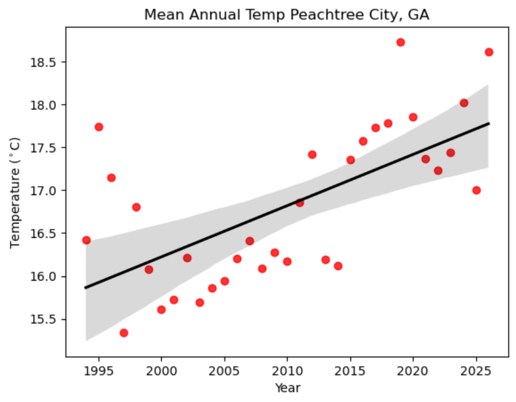
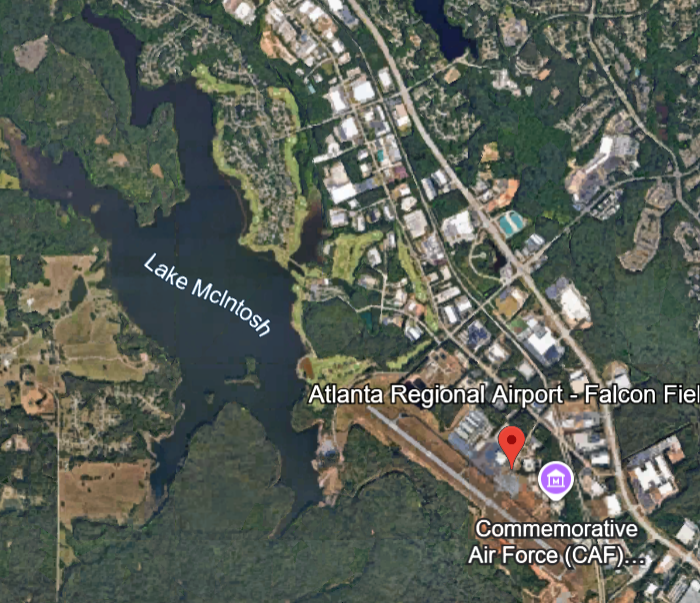
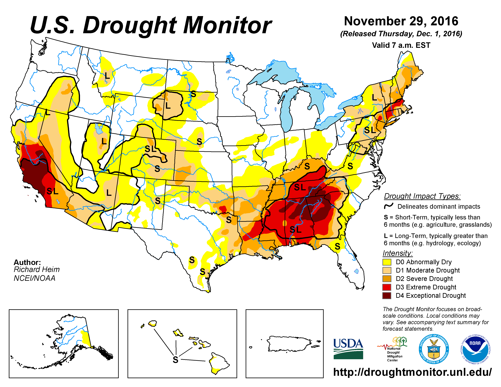

### Michael Pitts
Undergraduate at CU Boulder studying Geography w/ GIS emphasis, minor in Atmospheric and Oceanic Science. Currently working on GIS project for the community of Beulah Valley, Colorado to help recover after the Aspen Acres Fire. 

### Contact Information
* michael.pitts@colorado.edu
* [www.linkedin.com/in/michaelpitts21](www.linkedin.com/in/)

### Lake Peachtree
Map of Lake Peachtree located in Peachtree City, Georgia.

<embed type="text/html" src="img/lakeptc.html" width="600" height="600">

# Portfolio Posts

## Temperature Trend in Peachtree City, Georgia

### Overview

This project examines long-term changes in annual average temperature in Peachtree City, Georgia. Historical climate observations from Atlanta Regional Airport-Falcon Field were used to calculate annual average temperature and identify if a long-term trend exists. Unfortunately, data at this site only goes back to 1994 but is the most reliable data source in Peachtree City. 

### Data and Methods

I used historical climate data from NOAA's National Centers for Environmental Information (NCEI) through the Climate Data Online (CDO) portal. Monthly average temperature observations were grouped by year to calculate annual average temperature. A linear regression was then used to estimate the long-term trend in annual temperature.

### Annual Temperature Trends

**Figure 1. Annual average temperature in Peachtree City, Georgia.**

The annual temperature record shows year-to-year variability, but the overall trend is an increase in annual temperature. 
The linear regression indicates a change of approximately 0.06 degrees Celsius per year over the period analyzed. 

### Context

This site is located in an area where there has been minimal change in immediate surroundings as it is located at an airport and is the station used for the regional NWS office. While the period of record is short for most stations, this consistency of the site shows this increase in temperature over the last three decades is meaningful. However, there is one factor I believe should be considered for this site. As displayed by the graph above, average yearly temperatures were almost always below 17 Celsius prior to the mid-2010s. Starting in the mid-2010s, average yearly temperatures have all been right around or above 17 Celsius. This is significant because Lake Mcintosh, a 650 acres reservoir, reached full pool in the summer of 2013. Lake McIntosh is located immediately adjacent to the airport to the northwest, which is significant in proximity and also the fact that prevailing winds in this region are from the west and northwest. Winds typically are strongest in the fall through spring, which may lead to moderating temperatures locally especially during the cooler months of the year. Regardless, this station would likely show an overall increasing trend in temperature, but it could also be influenced by local changes.

**Figure 2. Lake Mcintosh proximity to airport.**

### Conclusion

Overall, the Peachtree City climate record shows an increase in temperature. However, this station may be biased post-mid-2010s due to changes in local geography with the introduction of Lake Mcintosh. A noticeable jump in temperature right after the reservoir filled gives reason to believe it may be influencing this site. I think it would be important to gather data from other stations in the area and compare to see if they had a similar jump in temperature around the same time in order to make a full conclusion about temperature trends in the area.

## American White Pelican Migration

### Species and Overview

American White Pelicans are one of the largest birds in North America. They spend their winters along the Gulf Coast, Mexico, Baja California, and California. When the weather warms, they migrate north to their nesting areas which include broad swaths of the Great Basin and the Great Plains, within the northern United States and into Canada (U.S. Army Corps of Engineers, St. Louis District, n.d.). This project displays the geographic distribution of American White Pelican occurrence records using an interactive map in 2024. The visualization uses georeferenced observations to explore spatial patterns across the species' range and examine how its distribution relates to seasonal migration.

### Data Sources

GBIF occurrence records provide georeferenced observations of the species. These records document reported locations rather than representing a complete census of the population. However, GBIF occurrence records are opportunistic observations and may be unevenly distributed. The map illustrates documented occurrences, not continuous migration routes or population abundance. Confirming seasonal migration patterns would require examining observation dates and comparing them with established research on the species.

### Methods

Occurrence records were retrieved from GBIF and processed using Python. Geographic data was prepared and combined with the occurrence records to produce visualization. The resulting map displays observations in their geographic context alongside ecoregion boundaries.

### Interactive Map

<embed type="text/html" src="img/pelicans6.html" width="600" height="600">

*American White Pelican occurrence records alongside ecoregion boundaries to provide geographic and ecological context*

### Key Observations

**Migration patterns and Geographic Distribution:**

- Winter (December–February): Observations of American White Pelicans are highly concentrated around the Gulf of Mexico, into Central America, around the Gulf of California, and have a notable presence in Cuba. Of these four regions, American White Pelicans are most concentrated around the Gulf of Mexico and the northern half of the Gulf of California. 

- Spring migration (March–April): Beginning in March, the highest values move to the northward to the lower Mississippi Valley and into the interior Great Basin. Come April, the highest concentrations have moved into the upper Mississippi Valley, spread further north in the Great Basin, and also have a notable presence in the Central Rockies and southern plains of Canada. 

- Nesting season (May–September): Observations become clearly concentrated in the northern Great Plains, Great Basin, and the interior Rockies from Colorado up to the Canadian border, as well as interior British Columbia. American White Pelicans also have a presence around the Great Lakes during this time, however more insignificant. In September, all of these areas continue to see concentrated observations, but these concentrations become less and have a shift southward as some White Pelicans begin to migrate back to more southerly latitudes. 

- Fall migration (October–November): In October, migration patterns are almost repeated exactly the same as in the spring migration. However, there does appear to be another path taken in the fall migration through the Central Valley in California, where water and food may be more available as compared to the Great Basin route at this time of year. 

**Research Context:** Previous research documented advances in American White Pelican spring migration timing between 2002 and 2011. King et al. (2017) found that spring departure and arrival dates became earlier over the study period, although the observed changes were not explained by winter temperature, precipitation, or vegetation green-up timing. These findings provide useful context for interpreting the seasonal distribution of occurrence records in this project. However, because this visualization represents observations from 2024 rather than tracked individuals across multiple years, it cannot determine whether the earlier migration trend continued or identify the environmental factors influencing migration timing.

**Limitations:** This data only covers 2024, so patterns may differ in other years or from the average trend. Additionally, these observations are observer based and can be biased based on population density and if people share what they see. A noticeable spike in May observations around the Great Lakes, followed by much fewer records in following months, may reflect differences in sampling effort, reporting activity, or actual seasonal distribution. Additional data would be needed to find the cause of this spike.

## References

GBIF.org (26 October 2026) GBIF Occurrence Download https://doi.org/10.15468/dl.ae872n

King, D., Wang, G., Yang, Z. et al. Advances and Environmental Conditions of Spring Migration Phenology of American White Pelicans. Sci Rep 7, 40339 (2017). https://doi.org/10.1038/srep40339

U.S. Army Corps of Engineers, St. Louis District. (n.d.). Pelican migration sheet [PDF]. https://www.mvs.usace.army.mil/Portals/54/docs/recreation/rivers/Birds/Pelican%20Migration%20Sheet.pdf

## Great Smoky Mountains NP Vegetation Health and Response to the 2016 Drought

### Area Overview

Great Smoky Mountains National Park is located in the Southern Appalachian Mountains, where it straddles the Tennessee and North Carolina border approximately 25 miles to the south of Knoxville, Tennessee and 30 miles west of Asheville, North Carolina. The park spans over 800 square miles, or more than 500,000 acres and has elevations ranging from 875 feet to 6,643 feet at the summit of Kuwohi. Precipitation is plentiful within the park, with around 55 inches of annual precipitation at the lower elevations and up to 85 inches each year on the park's highest peaks and favored ridges. 

The diverse range of elevation and high precipitation totals in the continental United States outside of the Olympic Peninsula in Washington create an exceptional environment for biodiversity. The park is home to over 22,700 species, with around 1,000 of those being unique to the area. Due to an extremely moist climate, the park is home to 30 salamander species, the highest concentration in the world. The park has an exceptionally diverse plant community approaching 2,500 unique species, but in general is dominated by spruce-fir, pine-oak, and oak-hickory among others depending on elevation and aspect.

The park is also the most visited national park in the country, peaking at over 14 million visitors in 2021. This is mainly due to the fact the park is located close to major population centers such as Nashville, Charlotte, and Atlanta (Park Statistics).

### Data and Methods

* Study area: I used the boundary of Great Smoky Mountains National Park from the National Park Service's boundaries dataset, which I downloaded as a geodatabase from the NPS Data Store and loaded in Python.

* NDVI data: I used NDVI from MODIS, a sensor on NASA's Terra satellite. The product is MOD13Q1 (version 061), with 250 m pixels that combine 16 days of images into one. I downloaded July images for 2015-2017 using NASA's AppEEARS API. I used July every year so the years can be compared fairly at maximum vegetation extent.

* Change in NDVI: For each pixel, I averaged and compared the July images from 2015 and 2016, as well as 2015 and 2017, then subtracted the before map from the after map. Positive values mean greener vegetation, and negative values mean less green (Figure 2).

### Context

**Figure 1. Drought monitor at the peak of the drought in GSMNP (U.S. Drought Monitor Map).**

As shown in the figure above, Great Smoky Mountains National Park was experiencing D3 and D4 drought conditions during late fall 2016. Regional soil moisture values had fallen to the second lowest level since 1895. Additionally, well above average fall temperatures led to headwater streams going dry, isolating fish and wildlife into pockets (Williams et al.). 

### Results

<embed type="text/html" src="img/gsmnp_dndvi1516.html" width="700" height="400">

**Figure 2. dNDVI from 2015 to 2016.**

The interactive map above shows the difference in NDVI across the park. The drought clearly has an immediate effect on vegetation, with values dropping notably across the park. The decline in vegetation health is much more prevalent in the northern two thirds of the park. 

<embed type="text/html" src="img/gsmnp_dndvi1517.html" width="700" height="400">

**Figure 3. dNDVI from 2015 to 2017.**

The interactive map above shows the difference in NDVI across the park. Come 2017, the majority of the park has rebounded to pre-drought levels of vegetation health. The only exception to this is in the north-central part of the park toward Gatlinburg, where the Chimney Tops 2 fire burned around 11,000 acres in November 2016. There are also isolated areas where vegetation health has failed to recover by July 2017.  

**Figure 4. NDVI values from 2015, 2016, and 2017.**

This table shows the quick recovery of vegetation in the park. Within months of the drought ending, NDVI values were back to where they were pre-drought, even with 11,000 acres in the park being burnt in 2016. 

### Conclusion

The immediate region around Great Smoky Mountains National Park experienced one of its worst droughts on record. The immediate short term impacts were felt especially along waterways and in animal behavior, yet it had minimal long term effects. Canopy health and overall vegetation health were back to pre-drought levels only months later. 

Timing is the main factor that contributed to such a quick recovery in vegetation health. The drought peaked in the fall, when radial and canopy development was done for the year ((Van Kampen et al.). Additionally, the spring and early summer was met with warm temperatures and plentiful rainfall. It has been demonstrated that subsequent-year spring weather accounts for upwards of 50% of ecosystem drought recovery speed. Normal or early warm spring conditions paired with moisture allows deciduous canopies to rebound within a single growing season, whereas delayed springs slow recovery (Li et al. 184). This was a perfect storm of one of the worst droughts in decades having little to no impact on vegetation health within the park.

Given more time, looking into the recovery around the Chimney Tops 2 fire would be a valuable topic. Fires of that size are rare in Appalachia, and would be a great case study in recovery and how to approach fires in the future in the area.

## References

Li, Yang, et al. "Widespread Spring Phenology Effects on Drought Recovery of Northern Hemisphere Ecosystems." Nature Climate Change, vol. 13, 2023, pp. 182-88. https://doi.org/10.1038/s41558-022-01584-2.

"Park Statistics." Great Smoky Mountains National Park, National Park Service, U.S. Department of the Interior, 2 June 2025, www.nps.gov/grsm/learn/management/statistics.htm. Accessed 24 Nov. 2026.

"U.S. Drought Monitor Map, November 29, 2016." U.S. Drought Monitor, National Drought Mitigation Center, University of Nebraska-Lincoln, December 1, 2016, droughtmonitor.unl.edu/Maps/MapArchive.aspx. Accessed 24 Nov. 2026.

Van Kampen, Ruth, et al. "Drought Timing and Species Growth Phenology Determine Intra-Annual Recovery of Tree Height and Diameter Growth." AoB Plants, vol. 14, no. 3, 18 Mar. 2022, article plac012. https://doi.org/10.1093/aobpla/plac012.

Williams, A. Park, et al. "The 2016 Southeastern US Drought: An Extreme Departure from Centennial Wetting and Cooling." Journal of Geophysical Research: Atmospheres, vol. 122, no. 20, 27 Oct. 2017, pp. 10888-905. https://doi.org/10.1002/2017JD027523.
